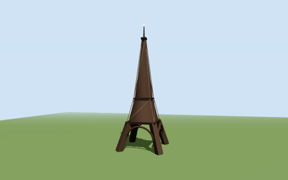
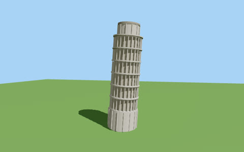
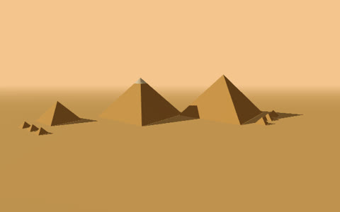
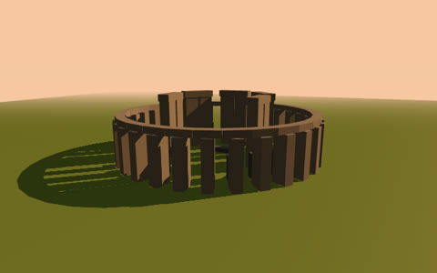
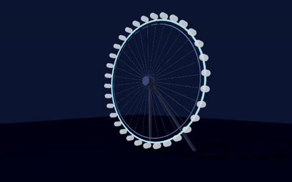
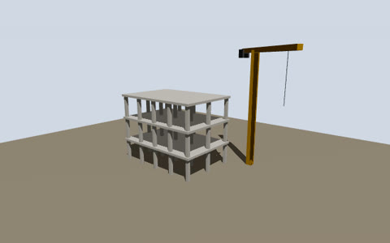
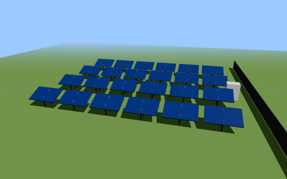
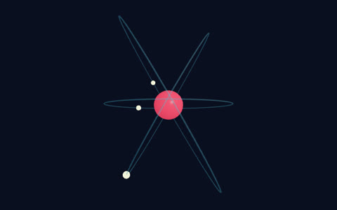
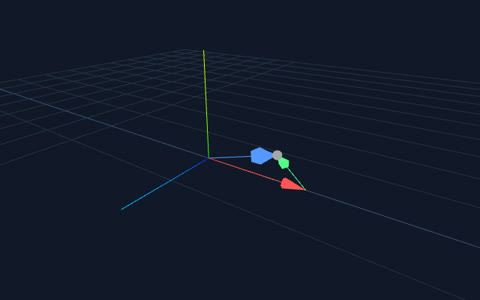
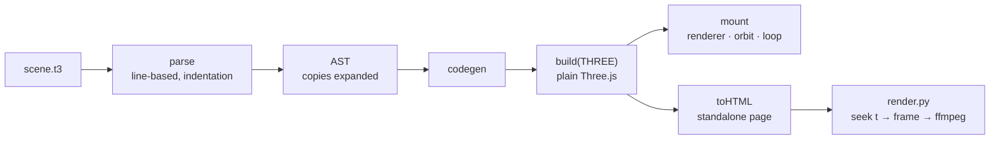

<div align="center">

# tinythree

**A tiny 3D scene language that compiles to Three.js.**<br>
Designed so AI models can write 3D scenes with **~3× fewer tokens**, faster and cheaper.

[](https://github.com/muskec06/tinythree/actions/workflows/ci.yml)
[](LICENSE)
[](https://threejs.org)
[](package.json)
[](https://muskec06.github.io/tinythree/)

[**Playground**](https://muskec06.github.io/tinythree/) · [Gallery](#gallery) · [Benchmark](#benchmark) · [Language](spec/LANGUAGE.md) · [AI prompt](ai/SYSTEM_PROMPT.md) · [Türkçe](README.tr.md)


</div>

---

## Why

When a language model writes Three.js, most of what it types is ceremony: `new THREE.Mesh(new THREE.BoxGeometry(…), material)`, `.position.set(…)`, render loops, resize handlers, easing math. Output tokens are the slowest and most expensive part of a model's answer.

tinythree gives the model a notation that only describes the scene: what is where, made of what, moving how. A zero-dependency compiler turns it into plain Three.js. The idea comes from [sand3d](https://github.com/Sandflow-ai/sand3d), which does the same for Blender. tinythree targets the web, and frame-exact video as well.

<table>
<tr><th>tinythree: 22 lines, 430 tokens</th><th>Three.js: 80 lines, 1,225 tokens</th></tr>
<tr>
<td valign="top">

```
mat iron #6a5240 r=.8 m=.3
mat lattice #8a6d55 wire
group legs ry=45
  box leg .45,2.4,.45 @0,1.1,0 iron rz=22 radial=4,1.9
torus arch 1.15,.07 @0,.85,0 iron arc=180 ry=90 radial=4,1.45
cyl top .2,1,5.2 @0,6.9,0 seg=4 ry=45 lattice
anim cam orbit 24s
```

</td>
<td valign="top">

```js
const iron = new THREE.MeshStandardMaterial(
  { color: 0x6a5240, roughness: 0.8, metalness: 0.3 });
const lattice = new THREE.MeshStandardMaterial(
  { color: 0x8a6d55, wireframe: true });
for (let i = 0; i < 4; i++) {
  const a = Math.PI / 4 + i * Math.PI / 2;
  const leg = add(new THREE.BoxGeometry(.45, 2.4, .45),
    iron, Math.cos(a) * 1.9, 1.1, Math.sin(a) * 1.9);
  leg.rotation.set(0, -a, deg(22));
}
// … arches, sections, camera orbit loop, resize …
```

</td>
</tr>
</table>

Full sources: [`examples/eiffel-tower.t3`](examples/eiffel-tower.t3) and [`bench/threejs/eiffel-tower.js`](bench/threejs/eiffel-tower.js).

## Benchmark


Each of the 10 scenes was written once in tinythree and once as compact, idiomatic Three.js. Loops and helper functions were allowed in the Three.js versions, and both versions were rendered to confirm they draw the same scene.

| | |
|---|---|
| **Tokens** | 9,141 → 2,906 in total, **3.1× fewer** (2.7×–3.8× per scene) |
| **Speed** | generation time grows roughly linearly with output tokens, so a scene takes about a third of the time to write |
| **One-time cost** | the [AI prompt](ai/SYSTEM_PROMPT.md) that teaches the language is ~1,200 tokens. It pays for itself after about two scenes and can be prompt-cached |
| **Edits** | changing one object means one short line, not a block of JavaScript |

Reproduce it with `npm run bench`, and see [bench/RESULTS.md](bench/RESULTS.md) for the full table. Counts use OpenAI's o200k tokenizer. Claude's tokenizer differs, but because both are BPE tokenizers the ratios come out similar. Even after subtracting the ~150 tokens of renderer setup that tinythree hides, the result is still 2.6× fewer.

## Gallery

Every scene below is a single `.t3` file of 7 to 22 lines. Click one to open it in the playground.

<table>
<tr>
<td align="center"><a href="https://muskec06.github.io/tinythree/#eiffel-tower"><br><b>Eiffel Tower</b></a><br><sub>430 tokens · 2.8× fewer</sub></td>
<td align="center"><a href="https://muskec06.github.io/tinythree/#leaning-tower-pisa"><br><b>Leaning Tower of Pisa</b></a><br><sub>316 tokens · 3.1× fewer</sub></td>
<td align="center"><a href="https://muskec06.github.io/tinythree/#giza-pyramids"><br><b>Pyramids of Giza</b></a><br><sub>293 tokens · 2.8× fewer</sub></td>
</tr>
<tr>
<td align="center"><a href="https://muskec06.github.io/tinythree/#stonehenge"><br><b>Stonehenge</b></a><br><sub>375 tokens · 3.0× fewer</sub></td>
<td align="center"><a href="https://muskec06.github.io/tinythree/#london-eye"><br><b>London Eye</b></a><br><sub>305 tokens · 3.3× fewer</sub></td>
<td align="center"><a href="https://muskec06.github.io/tinythree/#building"><br><b>Construction site</b></a><br><sub>322 tokens · 3.1× fewer</sub></td>
</tr>
<tr>
<td align="center"><a href="https://muskec06.github.io/tinythree/#solar-farm"><br><b>Solar plant</b></a><br><sub>253 tokens · 3.6× fewer</sub></td>
<td align="center"><a href="https://muskec06.github.io/tinythree/#atom"><br><b>Atom (education)</b></a><br><sub>234 tokens · 2.7× fewer</sub></td>
<td align="center"><a href="https://muskec06.github.io/tinythree/#vectors"><br><b>Vector addition (education)</b></a><br><sub>122 tokens · 3.8× fewer</sub></td>
</tr>
</table>

## Quick start

### 1. In the browser, with nothing to install

Open the [playground](https://muskec06.github.io/tinythree/), pick an example and edit it. The scene updates as you type. You can view the generated Three.js, download a standalone HTML page, or copy the AI prompt.

### 2. With an AI model

1. Put [`ai/SYSTEM_PROMPT.md`](ai/SYSTEM_PROMPT.md) in the system prompt, or paste it into the chat. The playground has a **📋 AI prompt** button that copies it.
2. Ask for a scene: *"the Colosseum at sunset, camera slowly orbiting"*.
3. Paste the answer into the playground, or run `tinythree build`.
4. If the compiler reports `line N: …`, send that line back to the model. Errors are short and come with a suggested fix.

### 3. Command line

```bash
git clone https://github.com/muskec06/tinythree && cd tinythree && npm install
node bin/tinythree.js build   examples/eiffel-tower.t3 -o eiffel.html   # standalone page
node bin/tinythree.js compile examples/eiffel-tower.t3 -o eiffel.js     # ES module
node bin/tinythree.js check   examples/*.t3                              # validate
```

### 4. From JavaScript

```js
import * as THREE from 'three';
import { OrbitControls } from 'three/addons/controls/OrbitControls.js';
import { compile, mount } from './src/tinythree.js';

const code  = compile(source, { format: 'fn' });
const built = new Function('THREE', code + '\nreturn build(THREE);')(THREE);
const view  = mount(THREE, built, document.body, { OrbitControls });

built.objects.ring.material.color.set('hotpink'); // everything is addressable by name
view.seek(2.5);                                    // jump to t = 2.5 s
```

## The language at a glance

```
scene bg=#0b1020 cam=4,3,6 look=0,1,0 orbit shadows dur=8s   // camera, background, flags
sun 5,10,7 2                                                  // lights: amb, hemi, sun, point
mat wood #8b5a2b r=.7                                         // material: color, roughness, metal, glow, opacity
box top 2,.1,1 @0,1,0 wood                                    // type [name] [size] [material] [@position]
box leg .1,1,.1 @.9,.5,.4 wood mirror=xz                      // copies: mirror, array, grid, radial
group lamp @.5,1,0                                            // indent to nest
  sphere bulb .08 #fff
use lamp lamp2 @-.5,1,0                                       // clone
anim lamp rot.y spin 4s                                       // spin, wave, to … at= ease=
anim cam orbit 20s
```

| | |
|---|---|
| **Shapes** | `box` `sphere` `cyl` `cone` `torus` `plane` `capsule` `lathe` `extrude` `arrow` `group` `use` |
| **Copies** | `mirror=xz` · `array=n,dx,dy,dz` · `grid=nx,nz,dx,dz` · `radial=n,r` |
| **Animation** | `spin` · `wave` · chained `to` tweens with `at=` and `ease=` · `anim cam orbit` |
| **Escape hatch** | `js` and `tick` blocks take raw Three.js for anything else |

The full reference is in [spec/LANGUAGE.md](spec/LANGUAGE.md).

## Video rendering

`update(t)` is a pure function of time, so every frame is rendered at an exact timestamp and the output doesn't depend on machine speed. This makes tinythree useful for educational videos and motion graphics.


```bash
pip install playwright && playwright install chromium   # once; ffmpeg must be on PATH
python tools/render.py examples/building.t3 -o building.mp4                     # length from scene dur=
python tools/render.py examples/atom.t3 -o atom.mp4 --fps 60 --size 1920,1080
python tools/render.py overlay.t3 -o overlay.mov       # scene bg=none → ProRes 4444 with alpha
python tools/render.py examples/atom.t3 -o thumbnail.png --still 1.5
```

## How it works



- **One file:** [`src/tinythree.js`](src/tinythree.js), about 600 lines with zero dependencies, running in the browser and in Node.
- **Readable output:** the generated code is ordinary Three.js that you can keep editing.
- **Errors for models:** for example `line 7: unknown command "spehre" (did you mean "sphere"?)`. One line, one fix.

## Project layout

```
src/tinythree.js      parser, compiler, runtime (mount) and HTML export
bin/tinythree.js      CLI
ai/SYSTEM_PROMPT.md   compact language description for LLMs (~1.2k tokens)
spec/LANGUAGE.md      full language reference
examples/             10 example scenes
playground/           live editor (GitHub Pages)
bench/                token benchmark, hand-written Three.js versions, chart
tools/render.py       frame-exact video and PNG renderer
test/                 node:test suite
```

## Roadmap

- [ ] **Part library:** doors, windows, stairs, trees, people, vehicles (`use lib:door`)
- [ ] **Text labels** and 2D overlays for educational videos
- [ ] **GLTF import/export** (`model chair.glb`)
- [ ] **CSG** booleans for openings in walls
- [ ] **AI eval:** first-try success rate across models, plus counts from Claude's own token counter
- [ ] **Claude skill and MCP server:** write, compile and render in one step

## Contributing

Issues and pull requests are welcome, especially new example scenes. A good example comes with its hand-written Three.js twin in `bench/threejs/` so the benchmark grows with it. Run `npm test` and `npm run bench` before opening a PR. See [CONTRIBUTING.md](CONTRIBUTING.md).

## Acknowledgments

- [three.js](https://threejs.org), which does all the real work.
- [sand3d](https://github.com/Sandflow-ai/sand3d), which showed that an LLM-first modeling language can cut tokens by several times.

## License

[MIT](LICENSE) © muskec06
