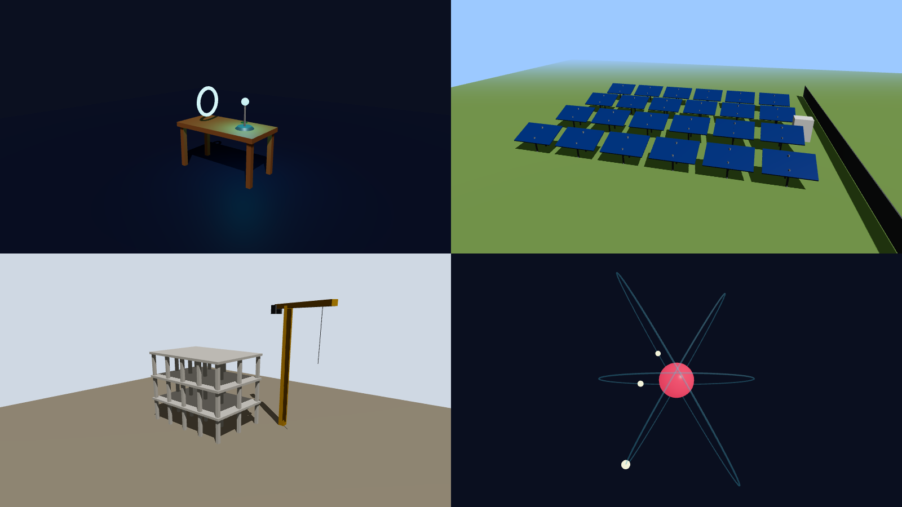
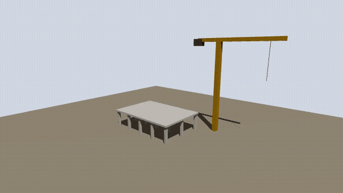

# tinythree

**A tiny 3D scene language that compiles to Three.js, designed so AI models can write 3D scenes with ~3× fewer tokens.**

[**▶ Try the playground**](https://muskec06.github.io/tinythree/) · [Language reference](spec/LANGUAGE.md) · [AI prompt](ai/SYSTEM_PROMPT.md) · [Benchmark](bench/RESULTS.md) · [Türkçe](README.tr.md)



When an LLM writes Three.js, most of its output goes to boilerplate: `new THREE.Mesh(new THREE.BoxGeometry(...), ...)`, `.position.set(...)`, render loops, resize handlers. Output tokens are the slow and expensive part, so tinythree gives the model a compact notation and leaves that boilerplate to a compiler. The idea comes from [sand3d](https://github.com/sandflow-ai/sand3d), which does the same for Blender. tinythree targets the web.

```
scene bg=#0b1020 cam=3.5,2.6,4.5 look=0,1,0 orbit shadows
amb .4
sun 5,10,7 2
mat wood #8b5a2b r=.7
mat neon #00e5ff glow=2
plane 20 #1a2340 floor
group table
  box top 2,.1,1 @0,1,0 wood
  box leg .1,1,.1 @.9,.5,.4 wood mirror=xz    // one line → four legs
torus ring .3,.04 @-.5,1.5,0 neon
anim ring rot.y spin 4s
anim neon glow wave .5 2s
```

The same scene takes [about 70 lines of Three.js](bench/threejs/table-lamp.js).

## Benchmark

Five scenes, each written once in tinythree and once by hand as compact, idiomatic Three.js (loops and helper functions allowed):

| scene | Three.js tokens | tinythree tokens | fewer tokens |
|---|---:|---:|---:|
| atom | 636 | 234 | **2.7×** |
| building | 994 | 322 | **3.1×** |
| solar-farm | 914 | 253 | **3.6×** |
| table-lamp | 968 | 256 | **3.8×** |
| vectors | 466 | 122 | **3.8×** |
| **total** | 3978 | 1187 | **3.4×** |

- **Fewer tokens means faster output.** Generation time grows roughly linearly with output tokens, so writing a scene takes about a third of the time.
- **One-time cost.** The prompt that teaches the language ([`ai/SYSTEM_PROMPT.md`](ai/SYSTEM_PROMPT.md)) is about 1,100 tokens. It pays for itself after about two scenes, and it can be prompt-cached.
- **Edits are smaller too.** Changing one object means rewriting one short line, not a block of JavaScript.

Reproduce with `npm run bench`. The numbers use OpenAI's o200k tokenizer. Claude's tokenizer differs, but because both are BPE tokenizers the ratios come out similar. Full details are in [bench/RESULTS.md](bench/RESULTS.md).

## Features

- **Zero dependencies.** A single ~600-line ES module that runs in the browser and in Node. The only peer dependency is `three`.
- **Primitives:** box, sphere, cyl, cone, torus, plane, capsule, lathe, extrude, arrow, plus groups, clones (`use`) and templates (`hidden`).
- **Repetition:** `mirror=xz`, `array=n,dx,dy,dz`, `grid=nx,nz,dx,dz`, which cover legs, columns, panels and rows.
- **Animation:** `spin`, `wave`, chained `to` tweens with easing and start times, camera `orbit`.
- **Escape hatch:** `js` and `tick` blocks take raw Three.js for anything the language can't express.
- **LLM-friendly errors:** for example `line 7: unknown command "spehre" (did you mean "sphere"?)`. The message can go straight back to the model, which then fixes only that line.
- **Frame-exact video:** `update(t)` is a pure function of time, so scenes render to MP4, ProRes 4444 or WebM, with alpha for overlays.

## Use it

### CLI

```bash
git clone https://github.com/muskec06/tinythree && cd tinythree && npm install
node bin/tinythree.js build   scene.t3 -o scene.html   # standalone page (Three.js from CDN)
node bin/tinythree.js compile scene.t3 -o scene.js    # ES module: export default build(THREE)
node bin/tinythree.js check   examples/*.t3            # validate
```

### JavaScript

```js
import * as THREE from 'three';
import { OrbitControls } from 'three/addons/controls/OrbitControls.js';
import { compile, mount } from './src/tinythree.js';

const code = compile(source, { format: 'fn' });
const built = new Function('THREE', code + '\nreturn build(THREE);')(THREE);
const view = mount(THREE, built, document.body, { OrbitControls });
view.seek(2.5); // jump to t = 2.5 s
```

`built.objects` and `built.materials` hold everything by name, so you can keep working in plain Three.js.

### With an AI model

1. Put [`ai/SYSTEM_PROMPT.md`](ai/SYSTEM_PROMPT.md) in the system prompt, or paste it into the chat. The playground has a **📋 AI prompt** button that copies it.
2. Ask for a scene: *"a wind turbine on a hill, blades spinning, camera orbiting"*.
3. Paste the result into the [playground](https://muskec06.github.io/tinythree/), or run `tinythree build`. If there is an error, send the error line back to the model.

### Video



```bash
pip install playwright && playwright install chromium   # once; ffmpeg must be on PATH
python tools/render.py examples/building.t3 -o building.mp4             # uses scene dur=
python tools/render.py examples/atom.t3 -o atom.mp4 --fps 60 --size 1920,1080
python tools/render.py overlay.t3 -o overlay.mov                        # bg=none → ProRes 4444 with alpha
python tools/render.py examples/atom.t3 -o thumb.png --still 1.5
```

Each frame is rendered by seeking to `t = i / fps`, so the result doesn't depend on machine speed.

## Project layout

```
src/tinythree.js      parser, compiler, runtime (mount) and HTML export
bin/tinythree.js      CLI
ai/SYSTEM_PROMPT.md   compact language description for LLMs
spec/LANGUAGE.md      full reference
examples/*.t3         example scenes
playground/           live editor (GitHub Pages)
bench/                token benchmark and hand-written Three.js versions
tools/render.py       frame-exact video and PNG renderer
test/                 node:test suite
```

## Roadmap

- [ ] Part library: doors, windows, stairs, trees, people, vehicles (`use door`)
- [ ] `text` labels and 2D overlays for educational videos
- [ ] GLTF import (`model chair.glb`) and export
- [ ] CSG (boolean) operations for openings in walls
- [ ] A Claude skill that writes, compiles and renders in one step
- [ ] Benchmark with Claude's own token counter and a success-rate eval (does the model get it right on the first try?)

## License

MIT. Contributions and ideas are welcome. Please open an issue.
