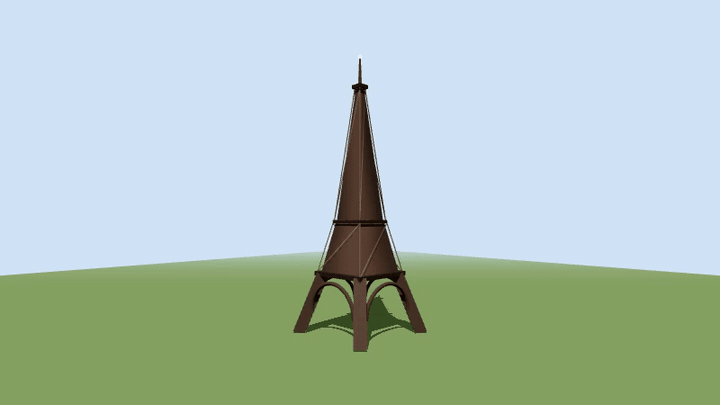

<div align="center">

# tinythree

**Three.js'e derlenen küçük bir 3D sahne dili.**<br>
Yapay zekâ modelleri 3D sahneleri **yaklaşık 3 kat daha az token** ile, daha hızlı ve daha ucuza yazsın diye tasarlandı.

[**Playground**](https://muskec06.github.io/tinythree/) · [Galeri](README.md#gallery) · [Dil referansı](spec/LANGUAGE.md) · [AI istemi](ai/SYSTEM_PROMPT.md) · [English](README.md)



</div>

## Neden?

Bir dil modeli Three.js yazarken çıktısının büyük kısmı tekrar eden kalıplara gider: `new THREE.Mesh(new THREE.BoxGeometry(…))`, `.position.set(…)`, render döngüsü, pencere boyutu ayarı. Çıktı tokenları ise yanıtın en yavaş ve en pahalı kısmıdır.

tinythree modele yalnızca sahneyi anlatan kısa bir yazım biçimi verir: ne nerede, neyden yapılmış, nasıl hareket ediyor. Bağımlılığı olmayan derleyici bunu düz Three.js'e çevirir. Fikir, aynı işi Blender için yapan [sand3d](https://github.com/Sandflow-ai/sand3d)'den geliyor. tinythree ise web'i ve kare kare videoyu hedefliyor.

## Ölçüm


10 sahne hem tinythree ile hem de elle, kısa ve deyimsel Three.js ile yazıldı. Sahnelerin beşi ünlü yapılar: 1.400 kafes kirişli detaylı Eyfel Kulesi, Pisa Kulesi, Giza Piramitleri, Stonehenge ve London Eye. İki sürüm de render edilerek aynı sahneyi çizdikleri doğrulandı.

- **Token:** Toplam 10.944'ten 3.593'e, yani **3,0 kat daha az** (sahneye göre 2,7× ile 3,8× arası).
- **Hız:** Üretim süresi çıktı tokenıyla neredeyse doğru orantılı. Bir sahne yaklaşık üçte bir sürede yazılır.
- **Tek seferlik maliyet:** Dili öğreten istem yaklaşık 1.400 token tutar ve 2 sahneden sonra kendini çıkarır.

Ölçümü yeniden almak için `npm run bench` yeterli. Ayrıntılar [bench/RESULTS.md](bench/RESULTS.md) dosyasında.

## Three.js'in tamamını kapsıyor mu?

Evet. Tarayıcıda çalışan bir test paketiyle kontrol edildi: [**35 yetenek testinin 35'i geçiyor**](docs/CAPABILITIES.md).

- **tinythree sözdizimi (13 test):** Şekiller, kafes kuleler, malzemeler, ışıklar, gölgeler, kopyalar, animasyon, perspektif ve ortografik kamera, video.
- **`js` / `tick` blokları (15 test):** Ek geometriler, cam ve shader malzemeleri, dokular, parçacıklar, glTF modelleri, iskelet animasyonu, fare ile seçim.
- **`renderer` bloğu (7 test):** Ton eşleme, ortam haritaları, post-processing (bloom vb.), HTML etiketleri, WebXR.

Token tasarrufu ilk gruptan geliyor. Diğer ikisi sahne dosyasının içinde yazılan düz Three.js'tir: Three.js kadar token tutar, ama tinythree'den çıkmadan yapılabilir.

## Hızlı başlangıç

- **Tarayıcıda:** [Playground](https://muskec06.github.io/tinythree/)'u aç, bir örnek seç ve düzenle. Sahne yazdıkça güncellenir.
- **Yapay zekâ ile:**
  1. [`ai/SYSTEM_PROMPT.md`](ai/SYSTEM_PROMPT.md) içeriğini modele ver.
  2. Sahneyi tarif et (örneğin "gün batımında Kolezyum, kamera yavaşça dönsün").
  3. Çıkan kodu playground'a yapıştır.
  4. Hata alırsan hata satırını modele geri gönder.
- **Komut satırından:**

```bash
git clone https://github.com/muskec06/tinythree && cd tinythree && npm install
node bin/tinythree.js build examples/eiffel-tower.t3 -o eiffel.html
python tools/render.py examples/building.t3 -o building.mp4      # kare kare video
```

## Eğitim videoları

Sahneler zamana bağlı saf bir `update(t)` fonksiyonu ürettiği için her kare tam zamanında render edilir. Sonuç bilgisayarın hızına bağlı değildir. `bg=none` ile şeffaf arka planlı ProRes 4444 (MOV) veya WebM çıkarıp kurgu programında başka görüntülerin üzerine bindirebilirsin.

Lisans: [MIT](LICENSE)
