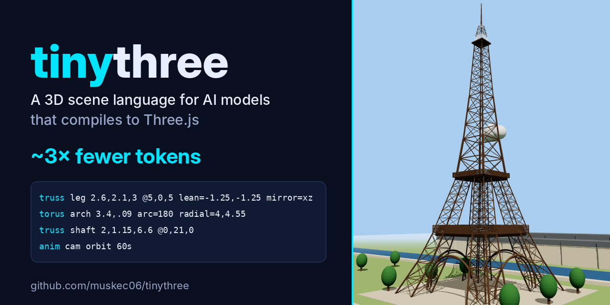
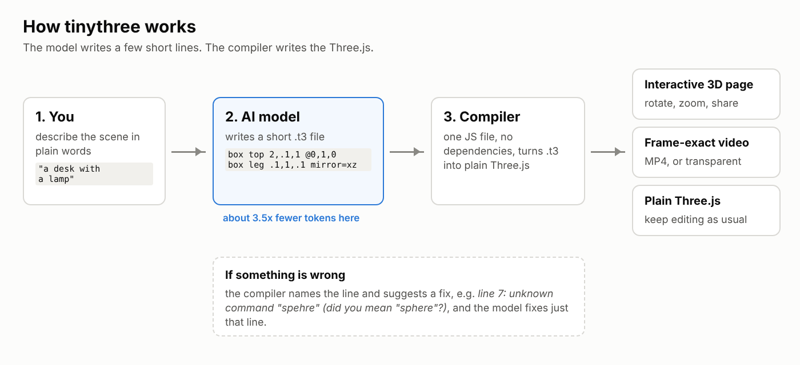
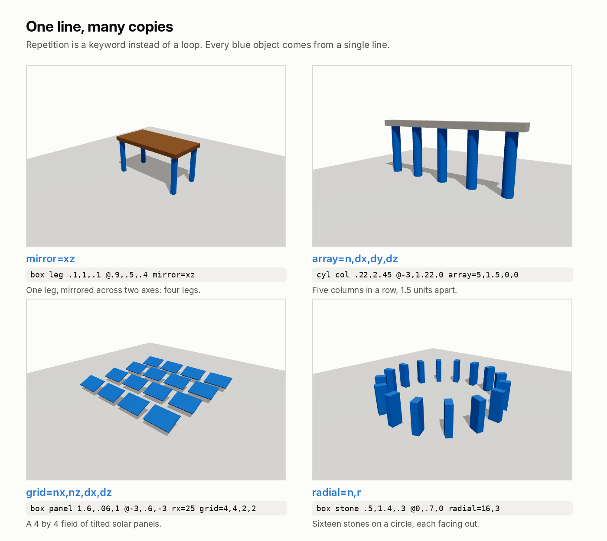
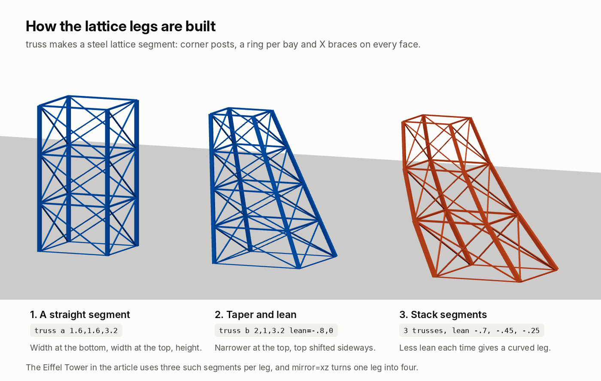
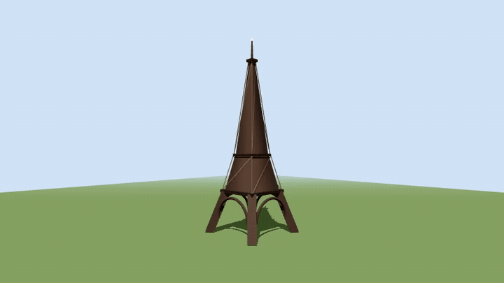
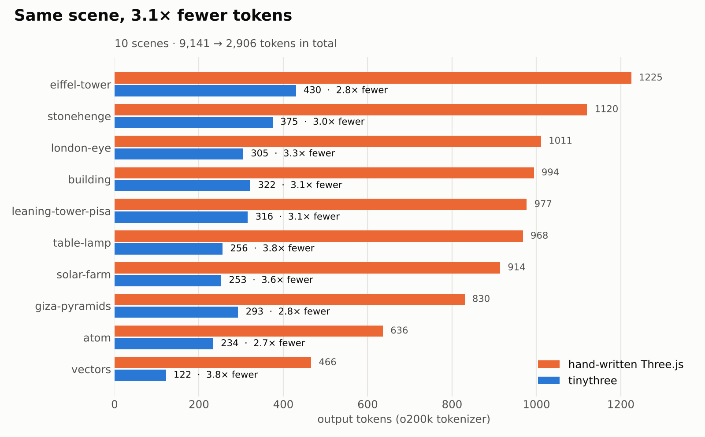
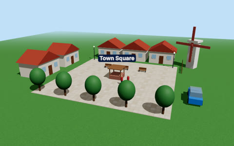
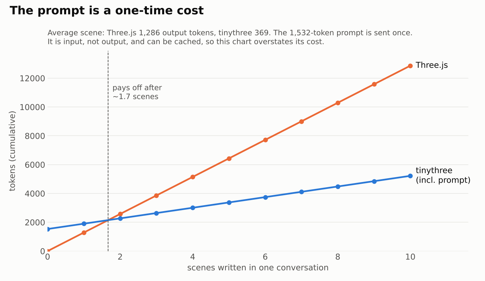

# 3.5x fewer tokens for AI-generated 3D scenes: meet tinythree

## tinythree is a tiny scene language that compiles to Three.js. Here is why I built it, how I measured it, and where it falls short.



When I ask an AI model to build a 3D scene in Three.js, the result is usually good. What bothered me was the cost of getting there. Most of what the model types isn't the scene. It's ceremony: creating a renderer, wiring up orbit controls, handling window resizes, writing `new THREE.Mesh(new THREE.BoxGeometry(...), material)` and then `.position.set(...)` again and again.

Output tokens are the slowest and most expensive part of a model's answer. Every line of boilerplate makes you wait and costs money, and it makes every small change slower too.

So I tried something simple. What if the model only had to *describe* the scene, and a compiler wrote the Three.js?



## The idea in one example

Here is a desk with four legs in plain Three.js:

```js
const wood = new THREE.MeshStandardMaterial({ color: 0x8b5a2b, roughness: 0.7 });
const top = new THREE.Mesh(new THREE.BoxGeometry(2, 0.1, 1), wood);
top.position.set(0, 1, 0);
scene.add(top);
for (const [x, z] of [[0.9, 0.4], [-0.9, 0.4], [0.9, -0.4], [-0.9, -0.4]]) {
  const leg = new THREE.Mesh(new THREE.BoxGeometry(0.1, 1, 0.1), wood);
  leg.position.set(x, 0.5, z);
  scene.add(leg);
}
```

And here is the same desk in tinythree:

```
mat wood #8b5a2b r=.7
box top 2,.1,1 @0,1,0 wood
box leg .1,1,.1 @.9,.5,.4 wood mirror=xz
```

That last line is one leg, mirrored across two axes, which gives you four. The compiler turns these three lines into ordinary Three.js like the code above. A scene file never needs a renderer, a camera loop or a resize handler; the compiler adds those.

## A few rules I followed

**One line per object.** Each line is a type, an optional name, a size, a material and a position. Options look like `key=value`. Everything else is a flag. The format is so regular that the whole language fits in a short prompt.

**Repetition is a keyword, not a loop.** Real scenes are full of repeated things: legs, columns, solar panels, stones in a circle, cabins on a Ferris wheel. `mirror`, `array`, `grid` and `radial` turn one line into many copies, and `use` clones a group you defined earlier.



**Common content is built in.** Text labels, glTF models, textures and a small library of real-size parts (trees, people, cars, doors, windows, stairs, houses) each take a single line:

```
use lib:house h1 @-7,0,-15 array=3,7,0,0
mat paving map=tiles rep=8,8
model mill assets/windmill.glb @14,0,-12 play
text sign "Town Square" @0,4,0 bg=#1b2a4a
```

**Errors are written for the model.** When something is wrong, the compiler names the line and suggests a fix, for example `line 7: unknown command "spehre" (did you mean "sphere"?)`. You can paste that straight back into the chat and the model fixes just that line.

**Three.js is never out of reach.** Anything the syntax doesn't cover can be written as plain Three.js inside the same file: custom shaders, particles, post-processing, WebXR. You never hit a wall. In that part you also save nothing, and that's fine.

## The Eiffel Tower test

To see whether this holds up beyond toy examples, I modeled the Eiffel Tower at real proportions. Its legs are curved steel lattices, which is exactly the kind of geometry that gets long in Three.js. tinythree has a `truss` command that builds a lattice segment, with corner posts, horizontal rings and X braces, in one line. Stacking a few segments with less and less lean gives you the curve:

```
truss leg1 2.6,2.1,3 @5,0,5 lean=-1.25,-1.25 iron mirror=xz
truss leg2 2.1,1.7,2.76 @3.75,3,3.75 lean=-.85,-.85 iron mirror=xz
truss leg3 1.7,1.25,5.84 @2.9,5.76,2.9 lean=-1.5,-1.5 iron mirror=xz
```



The whole scene, with the tower, arches, platforms, the Champ de Mars, the Seine, buildings, trees and drifting clouds, is 57 lines and about 1,400 lattice beams. The hand-written Three.js version is 165 lines.



## How I measured it

I wanted numbers I could defend, so I set a few rules for myself:

- Every scene is written twice: once in tinythree, and once as **compact, idiomatic Three.js**, the way a good developer would write it, with loops and helper functions allowed. Comparing against bloated code would have been easy and meaningless.
- **Both versions are rendered** and compared side by side, to make sure they really draw the same scene.
- Tokens are counted with OpenAI's o200k tokenizer. Other models use different tokenizers, but they are all BPE-based, so the ratios come out similar.
- Everything is in the repository, so anyone can rerun it with `npm run bench`.



Across 11 scenes, the total went from **14,151 tokens to 4,057, about 3.5 times fewer.** The range was wide, and the spread taught me more than the average did:

- **Town square** (parts, textures, a glTF model, a label): 3,207 → 464 tokens, **6.9x fewer**
- **Vector addition** (education): 466 → 122 tokens, 3.8x fewer
- **London Eye**: 1,011 → 305 tokens, 3.3x fewer
- **Stonehenge**: 1,120 → 375 tokens, 3.0x fewer
- **Eiffel Tower**: 3,028 → 1,117 tokens, 2.7x fewer



The biggest savings came from scenes built out of *things*: houses, trees, textures, a model, a label. Each of those is one line in tinythree and a block of code in Three.js. The smallest savings came from geometry built from scratch, like the Eiffel Tower, because a good developer writes a helper function for the lattice once and reuses it.

There is a fixed cost too. The model has to learn the language, and the prompt that teaches it is about 1,500 tokens. Since a scene saves around 900 tokens on average, the prompt pays for itself after about two scenes. It is also input rather than output, which is cheaper, and providers that support prompt caching make it cheaper still.



## Fewer tokens, faster answers

Generation time grows roughly in line with output tokens. So a model writing a third of the tokens finishes in roughly a third of the time. Edits benefit too: moving a building or changing a material means rewriting one short line, not a block of JavaScript.

## Video, frame by frame

Every tinythree scene compiles to a function of time, so any frame can be rendered at an exact timestamp. A small script turns a scene into an MP4, or into a video with a transparent background for editing. The output doesn't depend on how fast your computer is, which makes it useful for educational videos and presentations.

## What it isn't

- **It isn't a CAD or BIM tool.** It's for quick concept visuals, presentations and the web.
- **I haven't yet measured first-try accuracy across models.** The token savings are measured; how often each model gets a scene right on the first attempt is the next thing I want to test.
- **It's a new language.** Models don't know it from training, which is why the prompt and the readable error messages matter.

## Try it

The playground runs in your browser with nothing to install. Pick a scene, edit a line and watch it update:

**Playground:** [muskec06.github.io/tinythree](https://muskec06.github.io/tinythree/)

**Code (MIT, zero dependencies):** [github.com/muskec06/tinythree](https://github.com/muskec06/tinythree)

If you work with Three.js, AI tools, architecture or education, I'd really like to hear what you'd build with it and what's missing.
